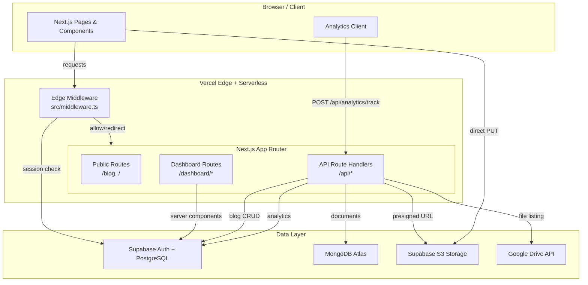
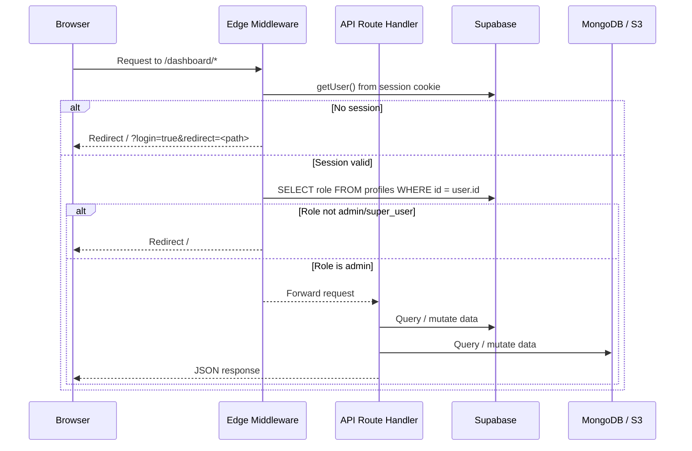
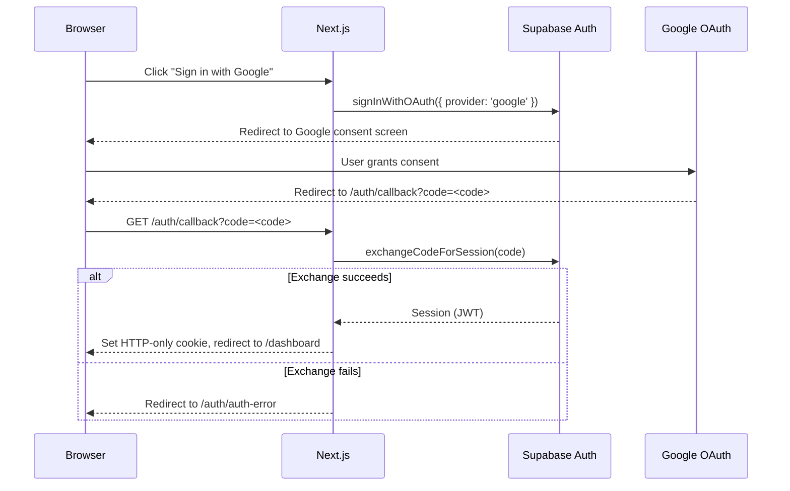
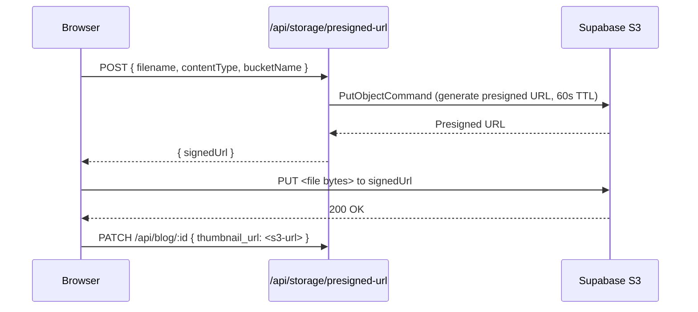

# Design Document: CMS Architecture

## Overview

This document describes the technical design for a production-ready CMS built on Next.js (App Router), deployed to Vercel, with Supabase as the primary auth and relational data store, MongoDB Atlas for flexible document storage, and Supabase S3-compatible storage for media assets.

The existing codebase already has working implementations of the core flows. This design formalises the architecture, defines canonical data models, establishes connection-management patterns for serverless, and specifies correctness properties for automated testing.

### Technology Stack

| Layer | Technology |
|---|---|
| Framework | Next.js 14+ (App Router) |
| Deployment | Vercel (Serverless Functions) |
| Auth | Supabase Auth (OAuth via Google) |
| Relational DB | Supabase PostgreSQL |
| Document DB | MongoDB Atlas |
| Object Storage | Supabase S3-compatible API |
| Middleware | Next.js Edge Middleware |
| External APIs | Google Drive API v3 |

---

## Architecture

### System Component Diagram



### Request Lifecycle



### OAuth Authentication Flow



### S3 Direct Upload Flow



---

## Components and Interfaces

### Next.js App Router Structure

```
app/
├── api/
│   ├── analytics/
│   │   ├── track/route.ts       # POST - insert analytics event
│   │   └── stats/route.ts       # GET  - aggregated stats
│   ├── blog/
│   │   ├── route.ts             # GET (list), POST (create)
│   │   └── [id]/route.ts        # PATCH (update), DELETE (remove)
│   ├── drive/
│   │   └── files/route.ts       # GET - list Drive files
│   ├── health/route.ts          # GET - health check
│   └── storage/
│       └── presigned-url/route.ts  # POST - generate S3 presigned URL
├── auth/
│   └── callback/route.ts        # GET - OAuth code exchange
├── blog/
│   ├── page.tsx                 # Public blog listing
│   └── [slug]/page.tsx          # Public blog post
└── dashboard/
    ├── layout.tsx               # Admin layout with sidebar
    ├── page.tsx                 # Dashboard overview
    └── blog/
        ├── page.tsx             # Blog management list
        ├── new/page.tsx         # Create post form
        └── [id]/edit/page.tsx   # Edit post form

src/
├── middleware.ts                # Edge middleware (auth + RBAC)
├── lib/
│   ├── supabase.ts              # Browser Supabase client (singleton)
│   ├── supabase-server.ts       # Server Supabase client factory
│   ├── mongodb.ts               # MongoDB singleton connection
│   ├── s3.ts                    # S3 client singleton
│   ├── blogs.ts                 # Blog data access helpers
│   └── utils.ts                 # Shared utilities
└── types.ts                     # Shared TypeScript types
```

### Middleware Interface

The Edge Middleware (`src/middleware.ts`) is the single enforcement point for auth and RBAC:

```typescript
// Matcher: /dashboard/:path*, /resources/:path*
async function middleware(request: NextRequest): Promise<NextResponse>
```

Responsibilities:
1. Create a Supabase client scoped to the edge request (reads/writes cookies on the response)
2. Call `supabase.auth.getUser()` — this validates the JWT and refreshes the session
3. If no user → redirect to `/?login=true&redirect=<path>`
4. If user exists → query `profiles.role`
5. If role is not `admin` or `super_user` → redirect to `/`
6. Otherwise → `NextResponse.next()` with updated cookie headers

### Supabase Client Factories

Two distinct factories prevent cookie-handling mismatches:

| Factory | File | Context | Cookie Strategy |
|---|---|---|---|
| `createClient()` | `src/lib/supabase-server.ts` | Server Components, Route Handlers | `await cookies()` from `next/headers` |
| `createClient()` | `src/lib/supabase.ts` | Client Components | `createBrowserClient` from `@supabase/ssr` |
| Middleware client | inline in `src/middleware.ts` | Edge Middleware | `request.cookies` + `response.cookies` |

### MongoDB Connection Utility

The `lib/mongodb.ts` module must implement a cached singleton to survive Vercel's module-level caching across warm invocations:

```typescript
// lib/mongodb.ts
let cachedClient: MongoClient | null = null;
let cachedPromise: Promise<MongoClient> | null = null;

export async function connectToDatabase(): Promise<MongoClient> {
  if (cachedClient) return cachedClient;
  if (!cachedPromise) {
    cachedPromise = MongoClient.connect(process.env.MONGODB_URI!);
  }
  cachedClient = await cachedPromise;
  return cachedClient;
}
```

The promise-level cache (`cachedPromise`) prevents multiple concurrent cold-start invocations from opening duplicate connections before the first resolves.

### S3 Client Singleton

`src/lib/s3.ts` already implements a module-level singleton (`let s3Client: S3Client | null = null`). The `getS3Client()` function initialises once and reuses across invocations within the same function instance.

---

## Data Models

### Supabase PostgreSQL Schema

#### `blogs` table

```sql
CREATE TABLE blogs (
  id            UUID PRIMARY KEY DEFAULT gen_random_uuid(),
  title         TEXT NOT NULL,
  slug          TEXT UNIQUE NOT NULL,
  content       TEXT,
  thumbnail_url TEXT,
  author_name   TEXT,
  metadata      JSONB DEFAULT '{}',
  created_at    TIMESTAMPTZ NOT NULL DEFAULT now(),
  updated_at    TIMESTAMPTZ,
  published_at  TIMESTAMPTZ
);

CREATE INDEX idx_blogs_published_at ON blogs (published_at DESC)
  WHERE published_at IS NOT NULL;
CREATE INDEX idx_blogs_slug ON blogs (slug);
```

#### `profiles` table

```sql
CREATE TABLE profiles (
  id         UUID PRIMARY KEY REFERENCES auth.users(id) ON DELETE CASCADE,
  role       TEXT NOT NULL DEFAULT 'user',
  created_at TIMESTAMPTZ NOT NULL DEFAULT now()
);

-- Auto-create profile on user signup
CREATE OR REPLACE FUNCTION handle_new_user()
RETURNS TRIGGER AS $$
BEGIN
  INSERT INTO profiles (id) VALUES (NEW.id);
  RETURN NEW;
END;
$$ LANGUAGE plpgsql SECURITY DEFINER;

CREATE TRIGGER on_auth_user_created
  AFTER INSERT ON auth.users
  FOR EACH ROW EXECUTE FUNCTION handle_new_user();
```

#### `analytics_events` table

```sql
CREATE TABLE analytics_events (
  id          UUID PRIMARY KEY DEFAULT gen_random_uuid(),
  event_name  TEXT NOT NULL,
  path        TEXT NOT NULL,
  session_id  TEXT NOT NULL,
  user_id     UUID REFERENCES auth.users(id),
  user_agent  TEXT,
  referrer    TEXT,
  metadata    JSONB DEFAULT '{}',
  created_at  TIMESTAMPTZ NOT NULL DEFAULT now()
);

CREATE INDEX idx_analytics_created_at ON analytics_events (created_at DESC);
CREATE INDEX idx_analytics_session_id ON analytics_events (session_id);
```

#### Row-Level Security Policies

```sql
-- blogs: public read of published, admin write
ALTER TABLE blogs ENABLE ROW LEVEL SECURITY;

CREATE POLICY "Public can read published blogs"
  ON blogs FOR SELECT
  USING (published_at IS NOT NULL AND published_at <= now());

CREATE POLICY "Admins can do everything"
  ON blogs FOR ALL
  USING (
    EXISTS (
      SELECT 1 FROM profiles
      WHERE id = auth.uid()
      AND role IN ('admin', 'super_user')
    )
  );

-- profiles: users own their row
ALTER TABLE profiles ENABLE ROW LEVEL SECURITY;

CREATE POLICY "Users can read own profile"
  ON profiles FOR SELECT
  USING (id = auth.uid());

CREATE POLICY "Users can update own profile"
  ON profiles FOR UPDATE
  USING (id = auth.uid());

-- analytics_events: anyone inserts, only admins read
ALTER TABLE analytics_events ENABLE ROW LEVEL SECURITY;

CREATE POLICY "Anyone can insert analytics events"
  ON analytics_events FOR INSERT
  WITH CHECK (true);

CREATE POLICY "Admins can read analytics events"
  ON analytics_events FOR SELECT
  USING (
    EXISTS (
      SELECT 1 FROM profiles
      WHERE id = auth.uid()
      AND role IN ('admin', 'super_user')
    )
  );
```

### TypeScript Types

```typescript
// src/types.ts
export interface Blog {
  id: string;
  title: string;
  slug: string;
  content: string;
  thumbnail_url?: string;
  author_name: string;
  metadata: Record<string, unknown>;
  created_at: string;
  updated_at: string;
  published_at?: string;
}

export interface Profile {
  id: string;
  role: 'user' | 'admin' | 'super_user';
  created_at: string;
}

export interface AnalyticsEvent {
  id: string;
  event_name: string;
  path: string;
  session_id: string;
  user_id: string | null;
  user_agent: string;
  referrer: string;
  metadata: Record<string, unknown>;
  created_at: string;
}

export interface AnalyticsStats {
  totalViews: number;
  uniqueVisitors: number;
  bounceRate: string;
  topPages: Array<{ path: string; views: number }>;
  chartData: Array<{ name: string; views: number }>;
}
```

### MongoDB Collections

MongoDB Atlas stores flexible document data that doesn't fit the relational model well — rich content blocks, drive-linked resource metadata, and extended CMS configuration.

#### `content_blocks` collection

```typescript
interface ContentBlock {
  _id: ObjectId;
  blog_id: string;          // references blogs.id in Supabase
  type: 'text' | 'image' | 'embed' | 'code';
  order: number;
  data: Record<string, unknown>;
  created_at: Date;
  updated_at: Date;
}
```

#### `drive_resources` collection

```typescript
interface DriveResource {
  _id: ObjectId;
  drive_file_id: string;
  name: string;
  mime_type: string;
  web_view_link: string;
  icon_link: string;
  modified_time: Date;
  size: number;
  linked_blog_id?: string;  // optional association to a blog post
  synced_at: Date;
}
```

---

## Correctness Properties

*A property is a characteristic or behavior that should hold true across all valid executions of a system — essentially, a formal statement about what the system should do. Properties serve as the bridge between human-readable specifications and machine-verifiable correctness guarantees.*

### Property 1: Session refresh on every protected request

*For any* path under `/dashboard/*` or `/resources/*`, when a valid session cookie is present, the middleware SHALL call the Supabase session refresh mechanism and forward the request with updated cookie headers.

**Validates: Requirements 1.4, 2.1**

---

### Property 2: Unauthenticated redirect preserves original path

*For any* protected path (under `/dashboard/*` or `/resources/*`), when no valid session exists, the redirect URL SHALL contain `login=true` and `redirect=<original_path>` as query parameters, preserving the exact original path.

**Validates: Requirements 2.2**

---

### Property 3: Non-admin role always denied dashboard access

*For any* role value that is not `admin` or `super_user` (including `user`, empty string, null, or arbitrary strings), an authenticated user with that role attempting to access any `/dashboard/*` path SHALL be redirected to `/` and SHALL NOT receive dashboard content.

**Validates: Requirements 2.4**

---

### Property 4: Blog list ordering invariant

*For any* set of blog posts with distinct `created_at` timestamps stored in Supabase, `GET /api/blog` SHALL return them in strictly descending `created_at` order — no two adjacent items in the response may have the earlier item appearing before the later one.

**Validates: Requirements 3.1**

---

### Property 5: Author name set from session metadata

*For any* authenticated user with a given `full_name` or `email` in their profile metadata, creating a blog post via `POST /api/blog` SHALL set `author_name` to `full_name` if present, otherwise to the email prefix before `@`.

**Validates: Requirements 3.2**

---

### Property 6: Unauthenticated POST always returns 401

*For any* blog post payload (regardless of content, size, or field values), a `POST /api/blog` request without a valid session SHALL always return HTTP 401 and SHALL NOT insert any record into the database.

**Validates: Requirements 3.3**

---

### Property 7: PATCH always updates `updated_at`

*For any* valid PATCH request to `/api/blog/:id` with any update payload, the resulting record in Supabase SHALL have `updated_at` set to a timestamp within 5 seconds of the request time.

**Validates: Requirements 3.4**

---

### Property 8: Delete then not-found

*For any* existing blog post with a known ID, after a successful `DELETE /api/blog/:id`, a subsequent `GET` or `PATCH` for that same ID SHALL return HTTP 404 — the record no longer exists.

**Validates: Requirements 3.5, 3.6**

---

### Property 9: Duplicate slug always returns 409

*For any* slug value that already exists in the `blogs` table, attempting to create a new blog post with that same slug via `POST /api/blog` SHALL return HTTP 409 and SHALL NOT insert a duplicate record.

**Validates: Requirements 3.7**

---

### Property 10: Published post requires non-empty title, slug, and content

*For any* blog post payload where `published_at` is set but at least one of `title`, `slug`, or `content` is empty or whitespace-only, the API SHALL reject the request and SHALL NOT persist the record.

**Validates: Requirements 3.8**

---

### Property 11: Public blog listing only shows published posts

*For any* collection of blog posts with mixed `published_at` states (null, future, past), the `/blog` page listing SHALL include only posts where `published_at` is non-null and less than or equal to the current timestamp — no draft or future-dated posts SHALL appear.

**Validates: Requirements 4.1**

---

### Property 12: Reading time calculation correctness

*For any* content string of length `n`, the displayed reading time SHALL equal `Math.ceil(n / 1000)` minutes. This holds for empty strings (0 minutes), single-character strings (1 minute), and strings of any length.

**Validates: Requirements 4.4**

---

### Property 13: Presigned URL request missing fields returns 400

*For any* combination of missing required fields (`filename`, `contentType`, `bucketName`) in a `POST /api/storage/presigned-url` request, the response SHALL be HTTP 400. This holds for any single missing field, any pair of missing fields, and all three missing.

**Validates: Requirements 5.2**

---

### Property 14: MongoDB connectToDatabase idempotence

*For any* number N ≥ 2 of sequential or concurrent calls to `connectToDatabase()` within the same Node.js process, all calls SHALL return the same `MongoClient` instance (reference equality). No additional connections SHALL be opened after the first successful connection.

**Validates: Requirements 6.2, 6.5, 6.6**

---

### Property 15: Analytics stats response shape for any valid range

*For any* valid range parameter (`24h`, `7d`, `30d`), `GET /api/analytics/stats` SHALL return a response containing all four required fields: `totalViews` (number), `uniqueVisitors` (number), `topPages` (array), and `chartData` (array).

**Validates: Requirements 7.3**

---

### Property 16: Invalid range defaults to 7d

*For any* range parameter value that is not `24h`, `7d`, or `30d` (including absent, empty string, or arbitrary strings), `GET /api/analytics/stats` SHALL return stats calculated over the 7-day window — the same result as explicitly passing `range=7d`.

**Validates: Requirements 7.4**

---

### Property 17: Unique visitor count equals distinct session IDs

*For any* set of analytics events with a known distribution of `session_id` values, the `uniqueVisitors` field in the stats response SHALL equal the count of distinct `session_id` values in that set — not the total event count.

**Validates: Requirements 7.5**

---

### Property 18: RLS blocks non-admin writes on blogs

*For any* authenticated user whose `profiles.role` is not `admin` or `super_user`, any INSERT, UPDATE, or DELETE operation on the `blogs` table SHALL be rejected by RLS. This holds for any blog record and any non-admin role value.

**Validates: Requirements 11.4**

---

### Property 19: RLS profile row isolation

*For any* two distinct user IDs A and B, user A's Supabase client SHALL NOT be able to SELECT or UPDATE user B's row in the `profiles` table. Each user can only access their own profile row.

**Validates: Requirements 11.5**

---

### Property 20: Analytics events insertable by any client, readable only by admins

*For any* analytics event payload, any client (authenticated or anonymous) SHALL be able to INSERT into `analytics_events`. For any non-admin user, SELECT on `analytics_events` SHALL be denied by RLS.

**Validates: Requirements 11.6**

---

## Error Handling

### Graceful Degradation Strategy

Each external service is treated as independently failable. The CMS degrades feature-by-feature rather than failing entirely.

| Service | Failure Mode | Degradation Behaviour |
|---|---|---|
| Supabase Auth | Unavailable | Middleware redirects all protected routes to `/`; public pages remain accessible |
| Supabase DB | Query error | API routes return HTTP 500 with error message; no data exposed |
| MongoDB Atlas | Connection failure | Log error on startup; MongoDB-backed features return 503; Supabase features unaffected |
| S3 Storage | Missing credentials | Log warning at startup; presigned-URL endpoint returns HTTP 500; no credentials in response |
| Google Drive API | Auth failure | Return HTTP 401 or 500 with upstream message; no crash |
| Missing env vars | Any | Log descriptive warning identifying the variable; disable only the affected feature |

### API Error Response Shape

All API routes return a consistent error envelope:

```typescript
// Success
{ data: T }

// Error
{ error: string }  // HTTP 4xx / 5xx
```

### Middleware Error Handling

The middleware must never throw — an unhandled exception in Edge Middleware blocks all requests. Wrap the entire middleware body in try/catch and fall through to `NextResponse.next()` on unexpected errors, logging the error server-side.

### Connection Error Handling

```typescript
// MongoDB — non-crashing startup failure
export async function connectToDatabase(): Promise<MongoClient | null> {
  try {
    if (cachedClient) return cachedClient;
    if (!cachedPromise) {
      cachedPromise = MongoClient.connect(process.env.MONGODB_URI!);
    }
    cachedClient = await cachedPromise;
    return cachedClient;
  } catch (err) {
    console.error('[MongoDB] Connection failed:', err);
    cachedPromise = null; // allow retry on next call
    return null;
  }
}
```

---

## Testing Strategy

### Dual Testing Approach

Unit tests cover specific examples, edge cases, and error conditions. Property-based tests verify universal properties across generated inputs. Both are necessary for comprehensive coverage.

### Property-Based Testing Library

Use **fast-check** (TypeScript-native, no additional setup required):

```bash
npm install --save-dev fast-check
```

Each property test runs a minimum of **100 iterations**. Tag each test with a comment referencing the design property:

```typescript
// Feature: cms-architecture, Property 14: MongoDB connectToDatabase idempotence
it('connectToDatabase returns same instance on repeated calls', async () => {
  await fc.assert(
    fc.asyncProperty(fc.integer({ min: 2, max: 20 }), async (n) => {
      const results = await Promise.all(Array.from({ length: n }, connectToDatabase));
      return results.every(r => r === results[0]);
    }),
    { numRuns: 100 }
  );
});
```

### Unit Test Coverage Targets

| Module | Test Focus |
|---|---|
| `src/middleware.ts` | Session check, role check, redirect URL construction (Properties 1–3) |
| `app/api/blog/route.ts` | CRUD operations, auth guard, ordering, slug uniqueness (Properties 4–10) |
| `app/blog/page.tsx` | Published filter, reading time calculation (Properties 11–12) |
| `app/api/storage/presigned-url/route.ts` | Missing field validation (Property 13) |
| `src/lib/mongodb.ts` | Singleton idempotence (Property 14) |
| `app/api/analytics/` | Stats shape, range defaulting, unique visitor count (Properties 15–17) |
| Supabase RLS | Policy enforcement via Supabase test helpers (Properties 18–20) |

### Integration Tests

- OAuth callback flow (mocked Supabase)
- S3 presigned URL generation (mocked AWS SDK)
- Google Drive file listing (mocked googleapis)
- Analytics event insertion end-to-end

### Smoke Tests

- Health endpoint returns `{ status: 'ok' }`
- All required environment variables present in CI
- MongoDB connection established with `MONGODB_URI`
- S3 client initialised with `forcePathStyle: true`
- Both Supabase client factories export valid clients

### RLS Testing

Use the Supabase CLI's `supabase test db` with pgTAP, or the JavaScript Supabase client with service-role and anon keys to simulate different user contexts:

```typescript
// Simulate anonymous client
const anonClient = createClient(url, anonKey);
// Simulate admin client
const adminClient = createClient(url, serviceRoleKey);
// Simulate regular user
const userClient = createClient(url, anonKey);
await userClient.auth.signInWithPassword({ email, password });
```
